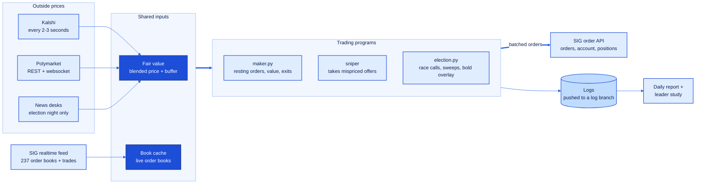
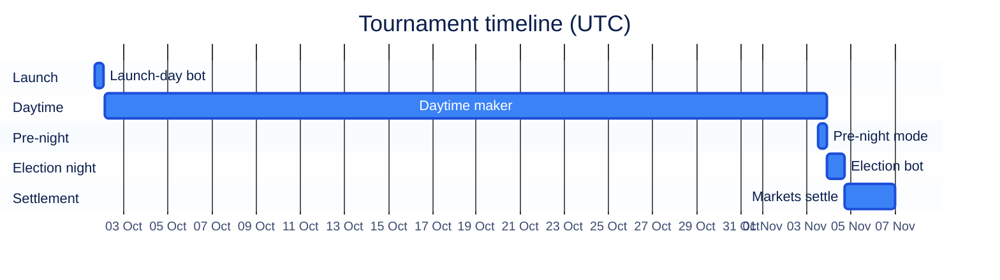
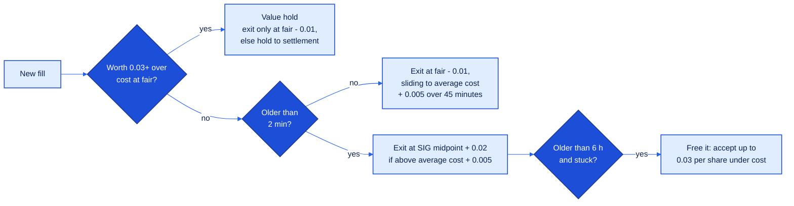
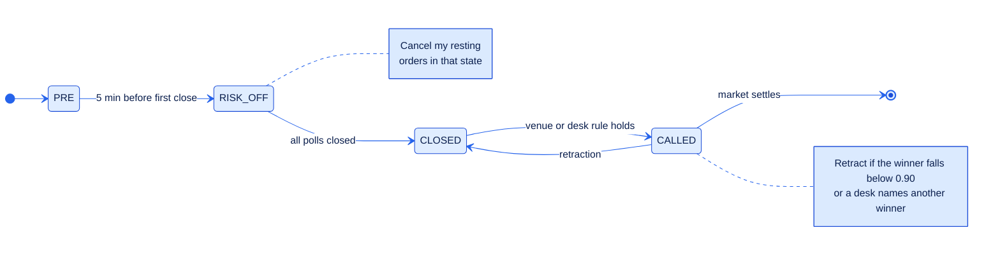
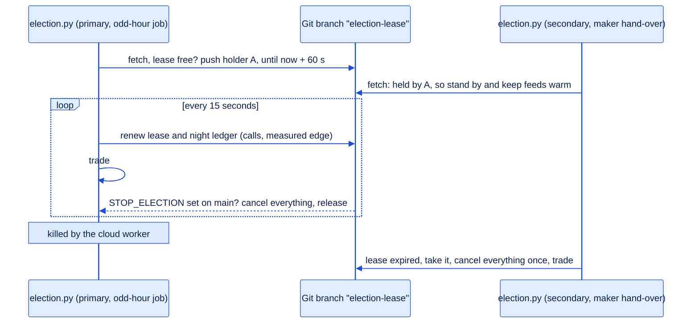
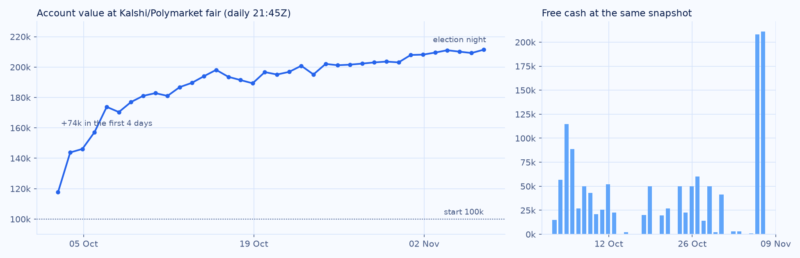
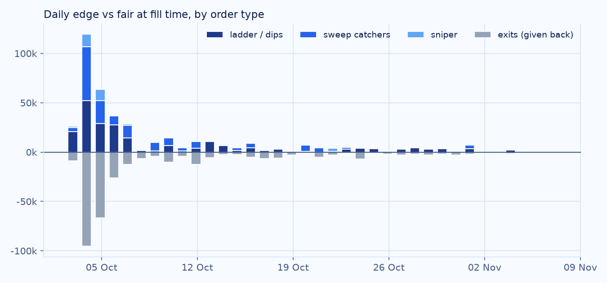
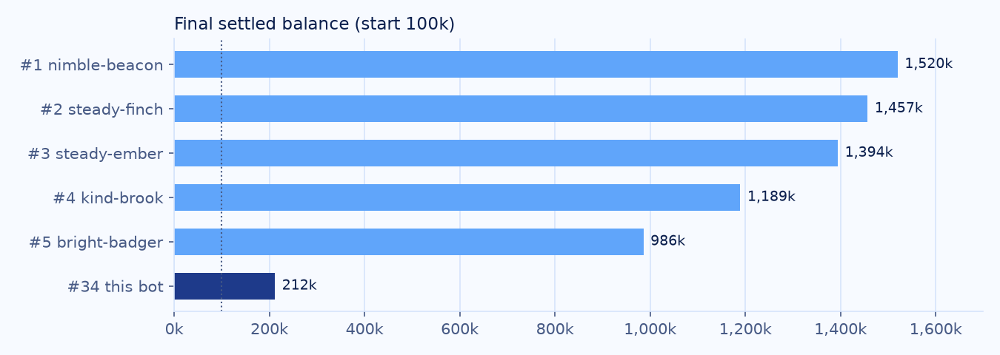

# SIG Predictions Cup 2026: an automated prediction-market trading bot

I built this bot for the **SIG Predictions Cup** (1 Oct to 4 Nov 2026), a play-money tournament on the 2026 US
midterm elections, run on SIG's own exchange (`sig.thesuper.market`). It ran as scheduled cloud jobs for 34 days,
and I kept an eye on it and tweaked it as I went. It posted standing offers, picked up shares that beginners'
panicked orders sold too cheaply, and grabbed any offer that was clearly out of line with Kalshi and Polymarket. On
election night it worked out who had won each race and traded on it.

| | |
|---|---|
| **Final rank** | **#34** |
| **Players** | 5,141 |
| **Starting balance** | 100,000 SUSQies |
| **Final balance** | **211,600** SUSQies |
| **Profit** | **+111.6k** (2.1×) |
| **Win rate / ROI / trades** | 80% / +1.9% / 3,300 |
| **Volume traded** | 5.97M SUSQies |
| **Edge earned on opening fills** | +404k versus outside fair (given back −311k on exits; see [lessons](#7-what-worked-what-didnt)) |
| **Race calls on election night** | 111 correct, 1 wrong |

> The tournament is over and every market has settled. This repository is a write-up plus the code behind it. The
> code talks to a competition service that no longer accepts trades.

---

## Contents

1. [The competition](#1-the-competition)
2. [System overview](#2-system-overview)
3. [Fair value: what is a contract worth?](#3-fair-value-what-is-a-contract-worth)
4. [The daytime maker (`maker.py`)](#4-the-daytime-maker-makerpy)
5. [Election night (`election.py`)](#5-election-night-electionpy)
6. [Operations: running in the cloud](#6-operations-running-in-the-cloud)
7. [Results: what worked, what didn't](#7-what-worked-what-didnt)
8. [Repository layout](#8-repository-layout)
9. [Running it](#9-running-it)

---

## 1. The competition

| Rule | What it meant for the bot |
|---|---|
| 237 yes/no markets: every Senate and Governor race, about 40 close House seats, and Senate/House control. Each race has one market **per party** | The two parties' prices should add up to roughly 1, but not exactly, because a candidate can run on more than one party's ticket |
| Prices run from 0.005 to 0.995 in steps of 0.005, and a winning share pays 1 | A price is simply a probability |
| Players trade with each other through an order book, and SIG adds a few thin quotes | The limit on how much I could trade was **how much was on offer, not how much cash we had** |
| Buying the opposite side of something you hold cancels the pair and **pays 1 straight away** | Cash can be freed up immediately instead of waiting for the race to be decided |
| A "buy now" order with no price defaults to paying up to 1 | Beginners' market orders sweep thin books, and the trades land far from fair value |
| Start with 100k play money; ranked by the balance **after settlement**; **only the top 3 are paid** | What matters is the chance of finishing top 3, not the average balance |
| Trading ran 1 Oct 16:00Z to 4 Nov 17:00Z; settlement follows certified results | Election night (3–4 Nov) was the one big moment everyone could see coming |

---

## 2. System overview



Daytime and night trading are separate programs with a hard hand-over at 3 Nov 21:37Z:



---

## 3. Fair value: what is a contract worth?

Everything is judged against the bigger prediction markets. `config/universe.json` links each SIG market to its
Kalshi twin (197 of 237) and its Polymarket twin (229 of 237), so **234 of 237** markets have an outside price to
compare with. `sigbot/outside.py` blends the two:

| Situation | Fair | Uncertainty buffer added to every edge test |
|---|---|---|
| Both venues, gap ≤ 0.02 | mean of the two mids | venue buffer |
| Both venues, gap 0.02–0.06 | mean | buffer + ½ × (gap − 0.02) |
| Both venues, gap > 0.06 | Kalshi | buffer + gap / 2 |
| Polymarket only | Polymarket midpoint | ≥ 0.005 |

I checked this afterwards: my purchases kept about 95% of their advantage after 30 minutes and about 80% after 2
hours, so I wasn't just buying things that were about to get cheaper.

**SIG's own price level** is the second reference. `Maker.anchor` takes the median midpoint of the order book over
the last 30 minutes. All month, SIG priced long shots 2–9c **above** the outside price, which left the favourites
cheap. Most decisions below come from the gap between SIG's level and the outside price: buy **under SIG's own
level** when you want to sell again quickly, and buy **under the outside price** when you plan to hold to settlement.

---

## 4. The daytime maker (`maker.py`)

### 4.1 One cycle

`maker.py` runs for ~2 hours per scheduled job and loops every 20 s:

```mermaid
%%{init: {'theme':'base','themeVariables':{'fontFamily':'trebuchet ms, verdana, arial, sans-serif','fontSize':'15px','primaryColor':'#E0EDFF','primaryBorderColor':'#1D4ED8','primaryTextColor':'#0B1F4D','secondaryColor':'#BFDBFE','tertiaryColor':'#F1F6FF','lineColor':'#2563EB','textColor':'#0B1F4D','clusterBkg':'#F1F6FF','clusterBorder':'#93B4F5','edgeLabelBackground':'#FFFFFF','actorBkg':'#E0EDFF','actorBorder':'#1D4ED8','actorTextColor':'#0B1F4D','signalColor':'#1D4ED8','signalTextColor':'#0B1F4D','noteBkgColor':'#DBEAFE','noteBorderColor':'#1D4ED8','noteTextColor':'#0B1F4D','taskBkgColor':'#3B82F6','taskBorderColor':'#1D4ED8','taskTextColor':'#FFFFFF','taskTextOutsideColor':'#0B1F4D','activeTaskBkgColor':'#1D4ED8','sectionBkgColor':'#EAF2FF','altSectionBkgColor':'#F7FAFF','gridColor':'#93B4F5','titleColor':'#0B1F4D','stateBkg':'#E0EDFF','stateLabelColor':'#0B1F4D','labelColor':'#0B1F4D'}}}%%
flowchart LR
    classDef box fill:#E0EDFF,stroke:#1D4ED8,stroke-width:1.5px,color:#0B1F4D;
    classDef key fill:#1D4ED8,stroke:#1E3A8A,stroke-width:1.5px,color:#FFFFFF;
    classDef store fill:#BFDBFE,stroke:#1D4ED8,stroke-width:1.5px,color:#0B1F4D;

    A["Refresh<br/>fair values"] --> B["Read account<br/>cash, positions,<br/>open orders"]
    B --> C{"Drawdown<br/>over 15k?"}
    C -->|"yes, after<br/>a re-read"| X["Cancel all<br/>and stop"]
    C -->|no| D["Build wanted<br/>orders by role<br/>and budget"]
    D --> E["Compare with<br/>resting orders,<br/>keep queue place"]
    E --> F["Send cancels and<br/>new orders<br/>4 batches of 50"]
    F --> G["Log the<br/>cycle"]
    G --> H{"Next even<br/>hour :29?"}
    H -->|no| A
    H -->|yes| Z["Leave orders resting<br/>150-minute expiry"]
    class A,B,D,E,F,G,Z box
    class C,H key
    class X store
```



Each cycle the bot compares the orders it wants with the ones already resting, instead of cancelling everything and
starting again. Every wanted order is matched to the closest-priced resting one, so orders keep their place in the
queue. Every order also expires on its own, so a crashed run can't leave stale offers sitting there for long.

### 4.2 Order roles

Each cycle builds its orders from a handful of roles. Each role is a guess about where other players get prices wrong.

| Role | Where it rests | Size | Why it makes money | Outcome |
|---|---|---|---|---|
| **Sweep catchers** (S/H) | buys at fair − 0.04 / 0.06 / 0.08 on both sides | up to 10–20k shares | Players' market orders sweep thin books; a resting order deep in the book gets filled at a price far from fair | **+153k** edge; the main earner on days 1–4 |
| **Ladder / dips** (L, D) | SIG's 30-min level − 0.04 / 0.05 / 0.06 (never > fair + 0.03) | 50k shares / 40k SUSQies on the 40 busiest markets in 16–24Z, ×0.25 elsewhere | A real dip under SIG's own market resells above cost within minutes | **+219k** edge (incl. the earlier tight ladder) |
| **Long-shot premium** (P) | offer the long shot at SIG midpoint + 0.04 / 0.08 / 0.13 (= buy the favourite) | 20k / 40k / 60k shares | Players dump whole balances into long shots (one market buy: 591k shares, 0.10 → 0.23) | big single fills, few of them |
| **Sniper** (thread) | takes offers ≥ 0.04 through fair where SIG's midpoint normally agrees with fair | ≤ 4k SUSQies, 2-min expiry, 30 s cooldown | Stale orders after an outside move | **+32k** edge |
| **Value buys / holds** (V) | takes offers ≥ 0.15 return to settlement, else rests at the bid | ≤ 40k per side, 60k per race | SIG priced favourites systematically under fair: hold them to settlement | ~10–15% to settlement on locked cash |

### 4.3 Exits and capital recycling

A fill on side A is exited by buying side B. SIG nets the pair and pays 1 at once, so cash comes straight back.



### 4.4 Capital: the engine caps resting buys at your cash

Standing buy orders don't reserve any cash, but the exchange limits each one to whatever your balance covers when it
actually fills. So **the biggest fill I could ever take was my free cash**, and every SUSQie tied up in a long hold
shrank the next bargain I could catch. Holding cheap favourites to settlement earns more per trade but locks cash up,
while keeping cash free means more, smaller trades. Balancing the two was the main design problem all month. See
[section 7](#7-what-worked-what-didnt).

---

## 5. Election night (`election.py`)

### 5.1 Why a separate bot

By mid-October it was clear I was far behind: 3rd place sat at about 970k and I was at about 200k. Careful
trading earned 1–10k a day, which would never close that gap. Election night was the one real chance, and **only the
top 3 were paid**, so the night bot works in three layers:

1. **Speed.** The moment a race is decided, buy the winner from players whose offers are still out of date.
2. **A bold overlay.** Bets across several races at once, sized to maximise the chance of finishing at or above 3rd
   place, not the average result.
3. **Holding.** Anything still held at the 17:00Z close simply pays 1 or 0.

### 5.2 Calling races

`sigbot/calls.py` tracks each race through a few stages and never calls one until **every** poll in that state has
closed. Some states close in two stages (Michigan's Upper Peninsula, and parts of Texas, Kansas, South Dakota and
Florida), so those times are listed in `POLL_CLOSE_H` and `POLL_FIRST_H`.



| Call rule | Condition | Confidence |
|---|---|---|
| Two venues | Kalshi **and** Polymarket ≥ 0.97 for 60 s | 0.99 |
| Strong + confirm | one venue ≥ 0.99, the other ≥ 0.95, for 60 s | 0.99 |
| One venue only | ≥ 0.99 for 300 s (House seats Kalshi doesn't list) | capped at 0.985 |
| Desk call | NBC or AP (via NYT) projects the race **and** a venue ≥ 0.95 (≥ 0.90 if both desks agree) | 0.985–0.99 |
| Contested race | leader < 0.80 at the close: waits 300 s in the first 30 min | |

The thresholds were calibrated on the 2024 election night (`research/calibrate_calls.py`, Kalshi 1-minute history,
52 races): a 1-minute 0.99 spike was wrong once (NY-04), and a 2-minute hold was never wrong. The desk rule beat
Kalshi's 0.97-for-2-min in 24 of 26 2024 calls, by a median of 28 minutes (`research/desk_lag_study.py`).

### 5.3 Night roles (budget priority order)

| Role | Action | Caps |
|---|---|---|
| **C** call sweep | buy the winner's YES and every loser's NO on every SIG level up to confidence − 0.02 | 25% of bankroll per race at confidence ≥ 0.99, 10% otherwise (cost already held counts) |
| **P** pairs | YES+YES (or NO+NO) in a two-party race when the offers sum to < 0.97 | spends only above 50% of the bankroll (locks cash to certification) |
| **B** bold | Monte Carlo overlay (below) | none before 8 calls |

### 5.4 Swing model and the bold overlay

Races are not independent: a national swing moves all of them at once. `sigbot/swing.py` models each race's
anti-R margin as

```
margin(race) = national swing + state effect + race noise
```

with priors taken from the pre-results prices (frozen at 00:00Z). It updates an exact grid posterior from race
calls, partial counts and outside-market moves, mixed over national standard deviation 1.5–6 points.

`sigbot/bold.py` then draws joint outcomes from that posterior. It treats every SIG offer as a candidate bet and
greedily picks the set that maximises a smoothed **P(final ≥ T)**, where T is the 3rd-place balance plus a random
allowance for the leaders' own night. Cash kept for the speed roles is assumed to earn the return actually measured
on the night so far: rich stale books mean bold keeps the cash; thin books late in the night mean bold bets.

### 5.5 Failsafes



| Risk | Mitigation |
|---|---|
| Two bots trading at once | a git-branch lease (`sigbot/lease.py`); pushes are never forced, so only one can win |
| A run is killed | the scheduled job restarts it; a hot standby takes over in ~45 s |
| GitHub down | after 90 s with no lease read the primary trades without it; the secondary never trades blind |
| Stale resting orders at poll close | risk-off cancels a state's orders 5 min before its first close; takes expire in 60 s |
| A wrong call | two-venue rules, a hold time, retraction below 0.90, per-race caps sized for a 1-in-100 miss |
| Emergency | `python stop_election.py on`, or create `config/STOP_ELECTION` on main from a phone |

Full design notes: [`docs/election_night.md`](docs/election_night.md).

---

## 6. Operations: running in the cloud

Nothing ran on my laptop. Scheduled cloud jobs ran the maker every 2 hours, a daily report, a daily study of the
leaders, and the election bot on the odd hours of 3–4 Nov. Logs went to a separate git branch.

A few safety rules held for the whole tournament:

- **Practice mode by default.** Anything that places real orders needs `--live`.
- The API key comes from the environment or a git-ignored `.env` file and is never logged.
- Every order expires on its own, so a run that dies leaves nothing behind for long.
- A loss limit (`--max-dd 15k`) switches the bot off if the account drops too fast. It re-reads the account first, so
  a fill landing mid-check can't set it off by mistake.
- Each run stops before the next even hour's :29 so two bots that place orders never overlap.

---

## 7. What worked, what didn't





**Where the money came from**

| Period | Account at fair | Change | Per day |
|---|---:|---:|---:|
| 1 Oct 16:00Z → 2 Oct 00:14Z | 100.0k | 0 | could not trade yet |
| 2 Oct → 6 Oct | 100.0k → 173.8k | **+73.8k** | ~15k |
| 6 Oct → 3 Nov | 173.8k → 211.1k | +37.3k | ~1.3k |
| Election night + settlement | 211.1k → 211.7k | ~+0.6k | |



**Worked**

- **Reliability.** 34 days of scheduled runs with no leaked keys, no runaway losses and clean hand-overs on election
  night.
- **Fair prices.** 234 of 237 markets had an outside price to compare with, and my trades kept most of their
  advantage afterwards.
- **Race calling.** 111 of 112 calls were right. The one miss (Mississippi Senate) had both outside markets at 0.976
  or higher before Democrats won, so "both markets agree" is not enough on its own.
- **Measuring before changing.** Replays of past trades caught rules that were losing money (selling holdings below
  fair value, the small market-making test), and I switched them off.

**What didn't**

- **Launch day decided the tournament, and I missed it.** In the first ~30 hours, beginners' market orders left
  around 10M SUSQies of mispricing. The eventual top three were already up 650–760k by day 2. I couldn't trade for
  the first 8 hours, and the launch bot was sized too small once I could.
- **Exits gave back most of the profit.** I bought cheap favourites, then sold them back minutes later at SIG's own
  lower price, handing the premium back to the crowd: +404k on the way in, −311k on the way out.
- **I played for the average, not for the top 3.** By election night nearly all my money was parked in safe
  favourites and I had just 1k of free cash. I had almost nothing to trade with, and the bold overlay couldn't do
  anything.
- **Too many strategy changes.** The cash policy flipped five times in the first week, and each flip locked in losses.
- **I gave up on market making too early.** The top two earned most of their profit by posting standing offers on
  both sides of the book at huge volume (25–32M). I tried it for two evenings with 500–1,000 shares at the back of
  the queue.

**Next time:** be fully live from the very first second, put the whole balance to work on day 1, decide early what
rank I need and plan for risk if careful trading can't get there, keep cash free for the one big known event, and
never sell below fair value.

The full analysis, including what the top players did and other approaches worth trying, is in
[`docs/postmortem.md`](docs/postmortem.md).

---

## 8. Repository layout

```
.
├── maker.py               daytime market maker (all roles in section 4)
├── election.py            election-night bot: live venue, lease, hand-over
├── swing.py               swing-model CLI (prices, baseline freeze, rehearsal)
├── sim_election.py        simulated election nights against a fake SIG
├── stop_election.py       remote kill switch (on | off | status)
├── daily_report.py        daily profit and loss by role at outside fair
├── leader_study.py        reverse-engineers leaderboard accounts from the tape
├── sigbot/                library
│   └── ...                shared library: exchange client, fair value, order books, race calling, lease
├── tools/                 setup and live checks (connectivity, snapshot, first order, realtime probe, order-path self-test)
├── research/              offline studies behind the numbers above (profit and loss, fill model, tapes, lags, call calibration, ...)
├── tests/                 offline tests (night engine, desk calls, follow-ups, pre-night sells)
├── config/                market maps (universe.json), busy/hot market lists, structural fairs
└── docs/                  post-mortem, election-night design, figures (+ the script and data that make them)
```

---

## 9. Running it

```bash
pip install -r requirements.txt
cp .env.example .env            # put SIG_API_KEY=... in it
python tools/step1_connectivity.py    # read-only API check
python maker.py --minutes 5           # dry run: logs the orders it would place
python election.py --steps 3          # dry run of the night engine on live data
```

Offline checks (no API key or network needed, except a dummy `SIG_API_KEY` for the maker tests):

```bash
python tests/test_night.py
python tests/test_desk.py
SIG_API_KEY=offline python tests/test_followup.py
SIG_API_KEY=offline python tests/test_night_sell.py
python sim_election.py --nights 20 --compare --races-cache races.json
python docs/make_figures.py
```

`sim_election.py` builds its race priors from Kalshi/Polymarket on first use and caches them in the `--races-cache`
file. Now that the 2026 markets have closed, those live prices may no longer be available.

`research/fill_model.py` also needs `pandas` and `scikit-learn`; `sigbot/desk.py` uses `brotli` if it is installed.
Logs and snapshots go to `logs/` and `data/` (git-ignored).

---

*Personal project, virtual currency only. No affiliation with Susquehanna International Group beyond participating in their public tournament. Not investment advice.*
